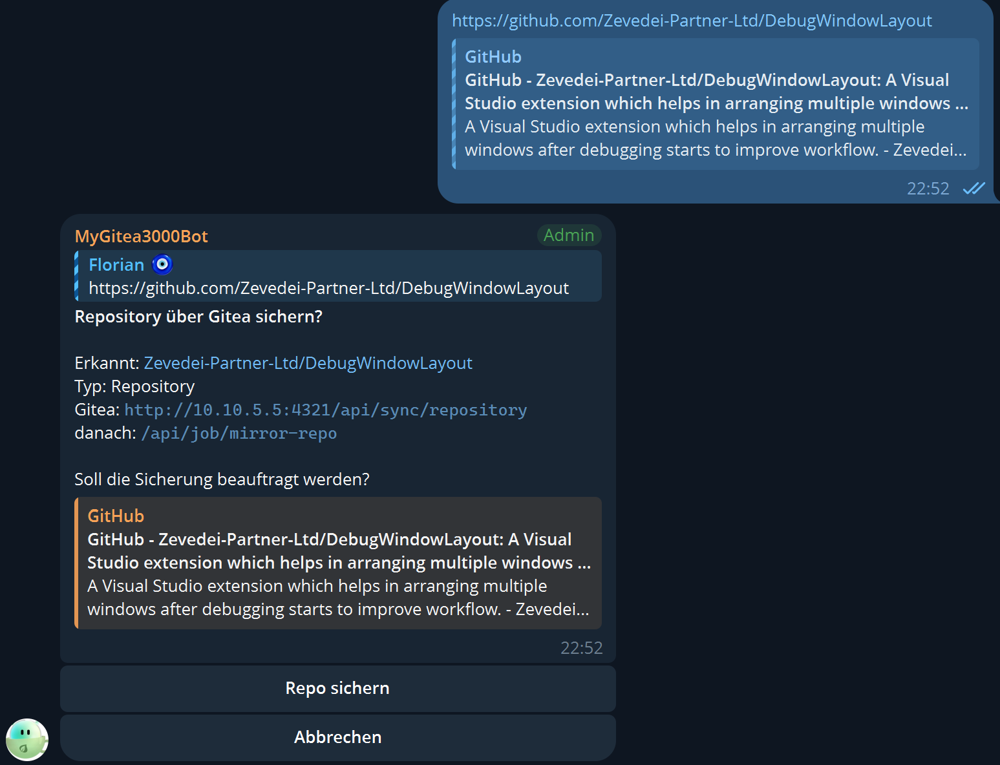
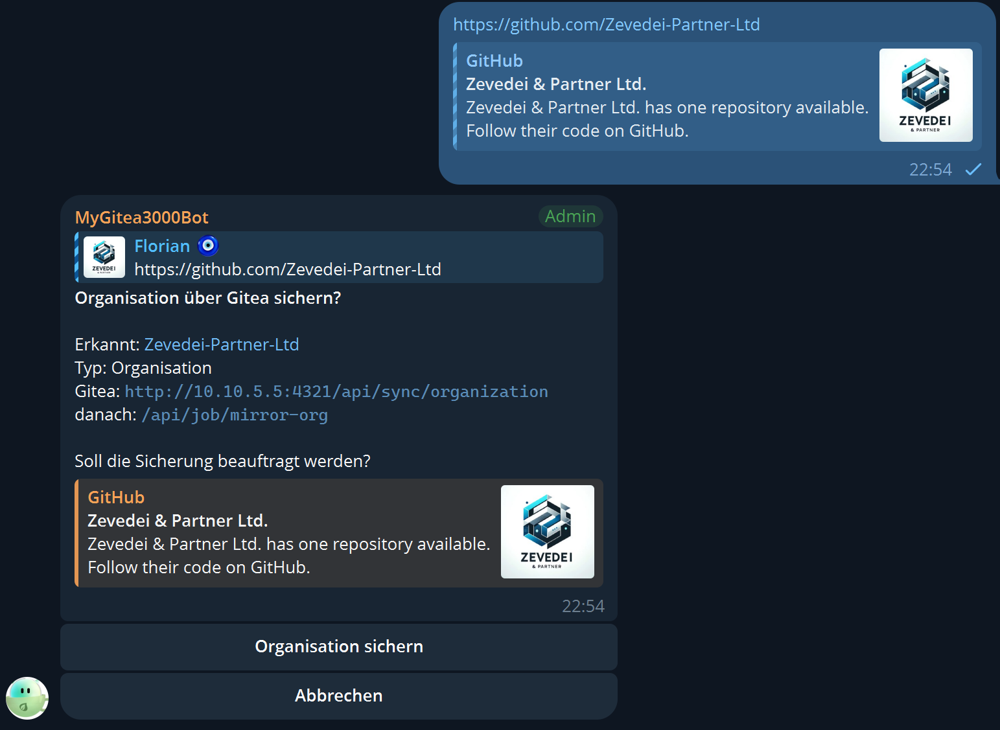

# GiteaBot

A Telegram bot that detects GitHub links posted in a group and, on demand, backs up a repository
or an organization through the **Gitea sync endpoints**. The application also exposes an HTTP
endpoint that lets Gitea push notifications back into the group (into the matching GitHub topic).

Everything runs in **a single process**: TelegramBotBase (long polling) + ASP.NET Core minimal API (Kestrel).

---

## 1. Setup

### 1.1 Create the Telegram bot
1. Use `/newbot` with **@BotFather** → note down the token.
2. Add the bot to the target group (ideally a **forum / topic group**).
3. So the bot reads **other people's** messages:
   - run `/setprivacy` with BotFather → **Disable**, **and**
   - grant the bot admin rights in the group (more reliable).

### 1.2 Find the chat ID and topic ID
- The **group chat ID** is negative, usually `-100…`. You can read it in the bot's log
  (`Group session opened: …`) or via `/status`.
- The **topic ID** (`message_thread_id`) of the GitHub topic: also visible in the log
  (`… / topic 42 …`). `0` or omitted = the General topic.

### 1.3 Configuration
Fill in `GiteaBot/appsettings.json` (template: `appsettings.example.json`).
Alternatively, pass secrets that should not be committed via environment variables:

| Variable | overrides |
|---|---|
| `API_KEY` | `Telegram:ApiKey` |
| `GITEA_API_KEY` | `Gitea:ApiKey` (`GITEA_TOKEN` is still accepted) |
| `GITEA_BASE_URL` | `Gitea:BaseUrl` |

Private overrides without touching `appsettings.json`: `appsettings.local.json`
(loaded automatically when present).

```json
{
  "Telegram": { "ApiKey": "123:ABC", "GroupId": -1001234567890, "TopicId": 0 },
  "Gitea":    { "BaseUrl": "https://gitea.example.com", "ApiKey": "" },
  "Http":     { "Urls": "http://0.0.0.0:5080" }
}
```

If required values are missing, startup aborts with a clear error message.

---

## 2. Running the bot

```bash
dotnet run --project GiteaBot
```

Output on startup:

```
╔══════════════════════════════════════════════════════════════
║ GiteaBot
║ Gitea webhook endpoint : http://0.0.0.0:5080/api/gitea/webhook
║ Health check           : http://0.0.0.0:5080/health
║ Gitea base URL         : https://gitea.example.com
║ Target group           : -1001234567890
╚══════════════════════════════════════════════════════════════
```

Bot commands: `/start`, `/help`, `/status`.

---

## 3. Flow inside the group

1. Someone posts `https://github.com/owner/repo` (paths like `/issues/3`, `/tree/main/…` are recognised too).
2. The bot replies **in the same topic** with the detected type and two buttons:
   `Backup repository` / `Backup organization` and `Cancel`.
3. **Cancel** → the bot's message is deleted, nothing else happens.
4. **Backup** → `POST {Gitea:BaseUrl}/api/sync/repository` or `/api/sync/organization`,
   then the question is deleted and the result is reported in the same topic.

Duplicate questions for the same link in the same group are suppressed while the question is still open.

### Screenshots

> **Note:** the screenshots below currently show a **German UI** – the texts were
> probably machine-translated when the pictures were taken. The current code sends
> English strings: the question is "Back up this Repository/Organization through
> Gitea?" with the buttons "Backup repository" / "Backup organization" and "Cancel".

**Repository** – the bot detected a repository link and asks whether to queue the backup:



**Organization** – the whole organization including all of its repositories
(`/api/sync/organization` followed by `/api/job/mirror-org`):



### Only the configured group is handled

Telegram delivers updates for **every** chat the bot is a member of. Therefore
`Telegram/ChatGuard.cs` checks `Telegram:GroupId` at every entry point:

| Entry point | Behaviour in a foreign chat |
|---|---|
| `StartForm.OpenGroup/OpenSupergroup` | Session stays on the inactive start form → `GroupWatchForm` is never opened |
| `GroupWatchForm.OnMessage/OnMessageEdit` | Message ignored (debug log) |
| `GroupWatchForm.Action` (inline buttons) | Callback discarded, alert popup "The bot is not active in this chat." |
| `/status` | No answer (the status output contains the chat ID and webhook address) |

In addition, a callback must come from the same chat the question was posted in – a
forwarded question message in another group therefore never triggers a backup. If
`Telegram:GroupId` is not set, the bot deliberately processes nothing at all. Private chats
(positive chat IDs) are always inactive.

### Payload sent to Gitea

Repository → `POST {Gitea:BaseUrl}/api/sync/repository`

```json
{ "owner": "octocat", "repo": "hello-world" }
```

Organization → `POST {Gitea:BaseUrl}/api/sync/organization`

```json
{ "org": "my-org" }
```

The DTOs live in `Gitea/GiteaSyncRequest.cs` (`RepositorySyncRequest`, `OrganizationSyncRequest`).
Since API v3.45.0 the optional `role` field is no longer sent – Gitea applies its own default.
The API key from `Gitea:ApiKey` is sent with every request in the **`x-api-key`** header
(header name: `GiteaApiClient.ApiKeyHeader`). If the key is missing, startup aborts with a
plain-text error.

### Immediately afterwards: the mirror job

After creating the record, the bot triggers the mirror job itself so the new repository or
organization is not merely present but actually mirrored:

Repository → `POST {Gitea:BaseUrl}/api/job/mirror-repo`

```json
{ "repositoryIds": ["9b2f..."] }
```

Organization → `POST {Gitea:BaseUrl}/api/job/mirror-org`

```json
{ "organizationIds": ["7c1a..."] }
```

The ids are taken **straight from the sync response** – Gitea returns the stored record
(`organization` / `repository` including its `id`) both on `200` and on `409 Conflict`
(`Gitea/GiteaSyncResponse.cs`, parsed by `GiteaApiClient.ParseSyncResponse`). A `409` therefore
no longer ends the flow: the existing record is simply mirrored again.

Example of a catalog record as returned by `GET {Gitea:BaseUrl}/api/github/repositories`:

```json
{
  "success": true,
  "message": "Repositories fetched successfully",
  "repositories": [
    { "id": "9b2f...", "name": "hello-world", "fullName": "octocat/hello-world",
      "owner": "octocat", "organization": null, "status": "mirrored",
      "mirroredLocation": "github-mirrors/hello-world",
      "lastMirrored": "2026-09-02T08:00:00.000Z", "errorMessage": null,
      "destinationOrg": null, "sourceProvider": "github", "isPrivate": false }
  ]
}
```

Fallback (`Gitea/GiteaCatalogService.cs`) – used only when the sync response carries no id:

| Link type | Lookup | Job |
|---|---|---|
| Repository | match on `fullName` (fallback: `owner` + `name`, case-insensitive) → `id` | `mirror-repo` |
| Organization | the `organization` id of every repository with that `owner`, must be unambiguous | `mirror-org` |

The catalog is cached for 30 s (`GiteaCatalogService.CacheLifetime`); after every sync the cache
is dropped with `Invalidate()` so a freshly created id is found immediately. If neither path
yields an id (record not in the catalog yet, `id`/`organization` empty, catalog unreachable),
the job is skipped and the answer states the reason – the record itself stays created. Any
`error` / `message` text from Gitea's JSON body is appended to the reply, so a `404` such as
"organization not found" (e.g. a user account posted instead of an org) is readable in the group.

Result in the group: `✅ Backed up`, `⚠️ Created, mirror job pending` (creation ok, job not),
`✅ Already in Gitea – mirrored`, `ℹ️ Already in Gitea, mirror job pending` or
`⚠️ Backup failed`.

### "In progress" status message

The operation consists of three to four HTTP round trips, so it can take anywhere from a few
seconds to several minutes. So the group does not just stare at an unanswered question during
that time, the bot posts a status message right after the click and **keeps editing it** –
exactly one message per operation, not one per step (`Telegram/BackupProgress.cs`).

```
⏳ In progress
Target: octocat/hello-world
Type: Repository
▶ Sending request to Gitea
running for 3 s
```

When the operation finishes, the same message is replaced by the result while the completed
steps stay visible as a log:

```
⏳ In progress
Target: octocat/hello-world
Type: Repository
✅ created via /api/sync/repository
✅ repository id 9b2f… taken from the sync response
▶ triggering mirror job
running for 41 s
        ↓  (edit)
✅ Backed up
Type: Repository
GitHub: octocat/hello-world
Create (/api/sync/repository): Repository created
Mirror job (/api/job/mirror-repo): Job queued
Requested by: Anna
```

Two constants protect Telegram's edit throttle (`message is not modified`, `too many requests`):

| Constant | Value | Purpose |
|---|---|---|
| `BackupProgress.MinEditInterval` | 1.5 s | edits that follow each other faster are dropped |
| `BackupProgress.HeartbeatInterval` | 5 s | only refreshes the elapsed time when Gitea is slow to answer |

If an edit fails (message deleted, interval too short), the result is sent as a new message
instead. If the operation itself throws, `BackupService` catches it and replaces the status
message as well – otherwise the group would be stuck with a permanent "In progress".
`CancelAsync` also deletes any status message that may still be standing.

---

## 4. Gitea → Telegram (webhook)

```
POST http://<host>:5080/api/gitea/webhook
Content-Type: application/json
```

```json
{
  "title": "Sync completed",
  "message": "Repository owner/repo was mirrored.",
  "type": "repository",
  "timestamp": "2024-05-01T12:34:56Z"
}
```

Response: `200 { "ok": true }`. The notification is forwarded to `Telegram:GroupId` and to the
topic `Telegram:TopicId` (0 = General). No authentication – intended for local execution.

`GET /health` → `{"ok":true,"time":"…"}`.

### Manual API testing with `.http` files

Two request files let you call everything straight from Visual Studio
(> right-click → "Send Request"):

| File | Target |
|---|---|
| `GiteaBot/gitea-mirror-api.http` | the Gitea Mirror API itself – catalog, sync, mirror jobs and the v3.45.0 error cases |
| `GiteaBot/giteabot-api.http` | the bot's own endpoints (`/health`, `/api/gitea/webhook`) |

The variables at the top (`@baseUrl`, `@api_key`, `@test_org`, `@test_repo`) are pre-filled with
the public test organization `Dev-DHCIP`; paste the real API key from `appsettings.json` – the key
is intentionally not stored in the repository.

---

## 5. Tests

```bash
dotnet test GiteaBot.Tests
```

85 tests cover link detection (repository vs. organization, path stubs, reserved owners,
foreign domains, duplicates), the chat guard (`ChatGuard`), the mirror-job payloads, id
resolution from the sync response (`GiteaSyncResponse`), the catalog fallback
(`GiteaCatalogService`) and the status message (`BackupProgress`).

Offline smoke test without Telegram/Gitea:

```bash
dotnet run --project GiteaBot -- --selftest
```

---

## 6. Publishing

`publish.ps1` at the solution root compiles the bot for all platforms and packs
each build as a ZIP archive:

```powershell
.\publish.ps1                                        # asks for version and variant
.\publish.ps1 -Version 1.2.0 -Variant SelfContained  # non-interactive
```

| Aspect | Details |
|---|---|
| Targets | `win-x64`, `win-arm64`, `osx-x64`, `osx-arm64`, `linux-x64`, `linux-arm64` |
| Variants (`-Variant`) | `FrameworkDependent` (~1 MB, requires the .NET runtime on the target), `SelfContained` (~45–50 MB, ships the runtime) or `All` (default) — the interactive prompt also accepts `1`/`2`/`3` |
| Version | prompted if not passed, format `MAJOR.MINOR.PATCH[-PreRelease]`; stamped into the assemblies too |
| Output | `Publish\` at solution level, one ZIP per target + variant: `GiteaMirrorBot-<version>-<rid>-<variant>.zip` |
| Secrets | the real `appsettings.json` is never shipped — each package contains a copy of `appsettings.example.json` instead |

---

## 7. Project structure

```
GiteaBot/
├─ Program.cs                     host, DI, console banner for the endpoint
├─ BotHostedService.cs            bot lifecycle (start/stop) inside the web host
├─ SelfTest.cs                    offline smoke test of link detection
├─ ServiceRegistration.cs         DI wiring
├─ gitea-mirror-api.http          manual test harness for the Gitea Mirror API
├─ giteabot-api.http              manual test harness for the bot's own endpoints
├─ Configuration/AppSettings.cs   configuration + validation
├─ Forms/StartForm.cs             splitter form: private → help, group → watcher
├─ Forms/GroupWatchForm.cs        reads every group message, buttons, callbacks
├─ Forms/HelpForm.cs              short usage description (private chats)
├─ Analysis/GitHubLinkAnalyzer.cs link detection, repository/organization decision
├─ Analysis/GitHubLink.cs         model (kind, owner, repo, canonical URL)
├─ Telegram/TopicSender.cs        always sends into the right forum topic (+ edit for status)
├─ Telegram/BackupProgress.cs     "In progress" message kept up to date via edits
├─ Telegram/Html.cs               HTML escaping for Telegram messages
├─ Telegram/ChatGuard.cs          only reacts in Telegram:GroupId (groups, callbacks, /status)
├─ Gitea/GiteaApiClient.cs        POST /api/sync/…, GET /api/github/repositories, POST /api/job/mirror-…
├─ Gitea/GiteaSyncRequest.cs      create payloads (owner/repo, org)
├─ Gitea/GiteaSyncResponse.cs     sync response DTOs (record ids on 200 and 409)
├─ Gitea/GiteaJobRequest.cs       mirror-job payloads (repositoryIds, organizationIds)
├─ Gitea/GitHubRepositoryEntry.cs model for GET /api/github/repositories
├─ Gitea/GiteaCatalogService.cs   GitHub link → ids for the mirror jobs (cached, fallback only)
├─ Services/BackupService.cs      create → mirror job → delete question → report
├─ Services/PendingRequestStore.cs open questions (short callback ids)
├─ Services/NotificationRouter.cs Gitea notification → group/topic
├─ Services/BotServices.cs        composition root for the forms
└─ Web/GiteaWebhookEndpoint.cs    minimal API endpoints
```

---

## 8. Notes / limitations

- Open questions live **in memory** and are gone after a restart; the buttons that were already
  sent then answer "This request is no longer open."
- `UseSingleThread` preserves the order of the group messages; the Gitea operation deliberately
  runs asynchronously so the group is never blocked.
- The bot ignores **its own** messages (no feedback loop with its own answers).
